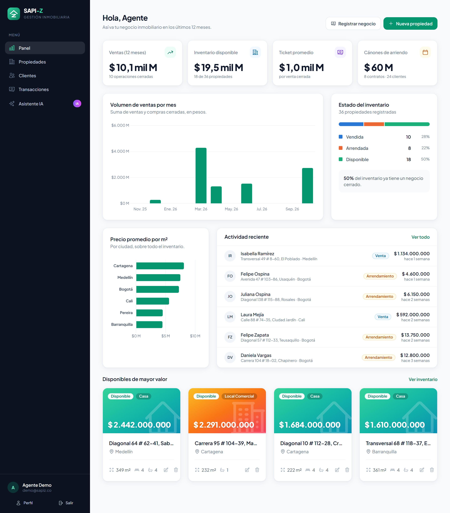
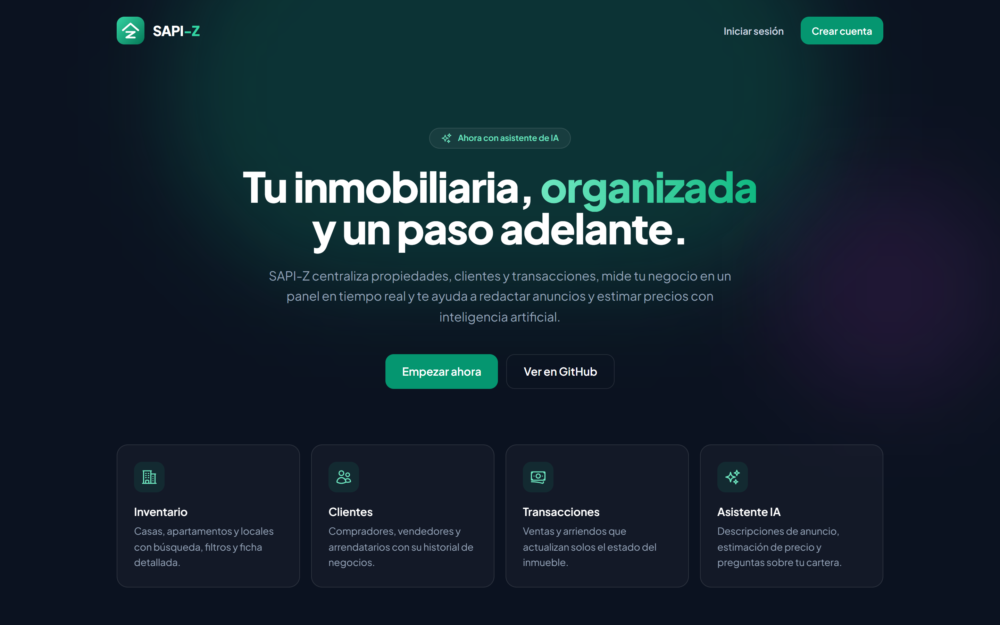
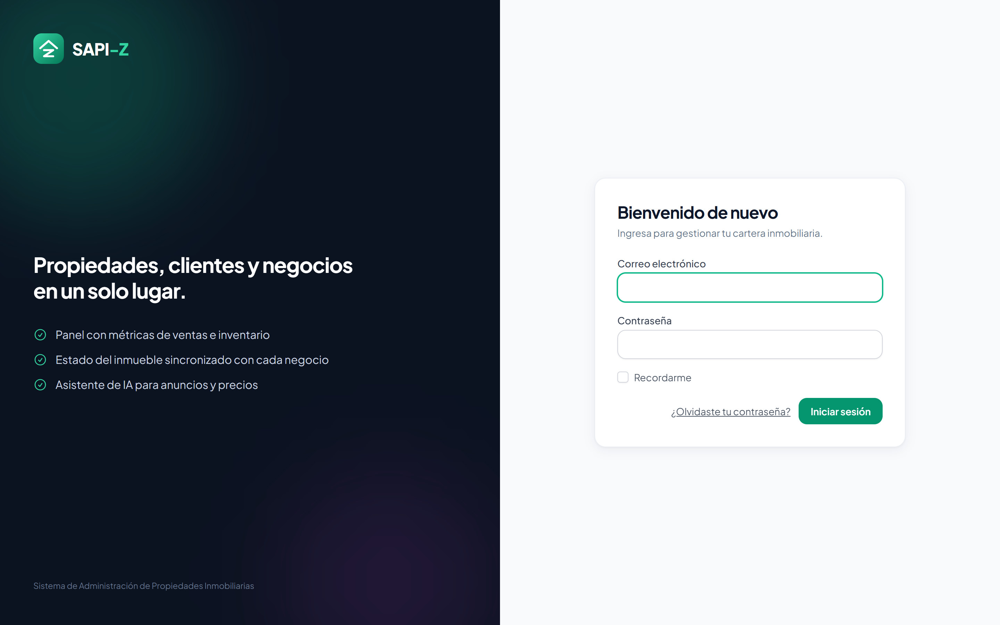
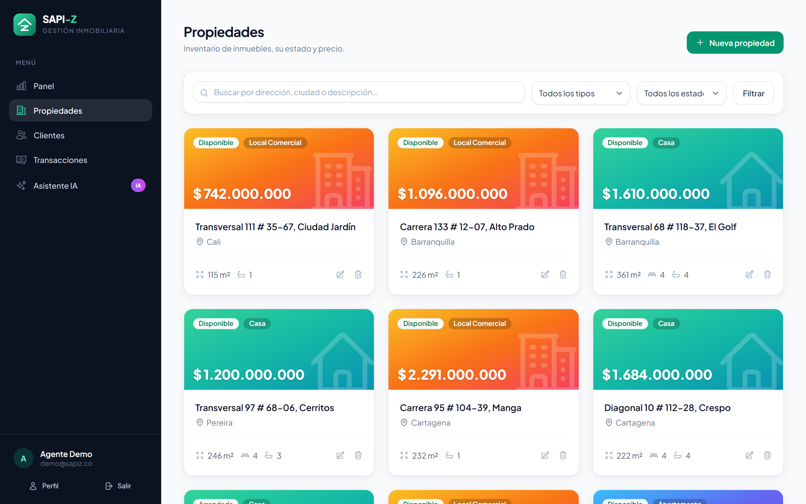
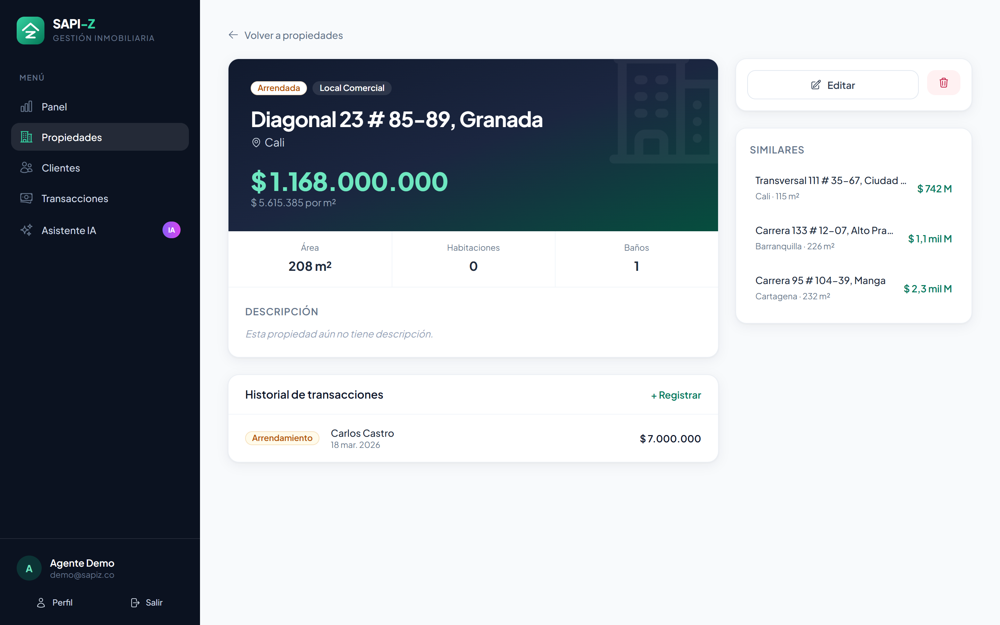
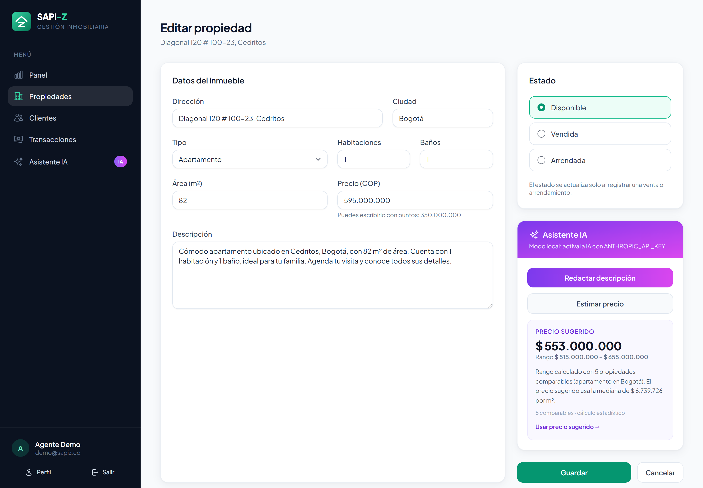
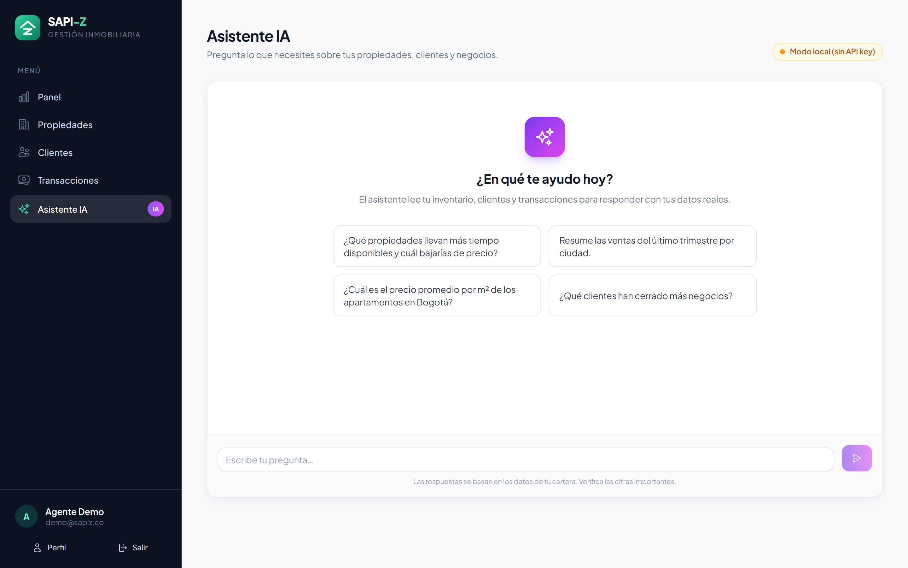
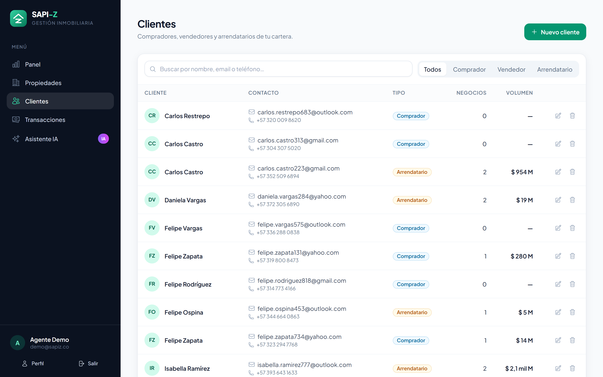
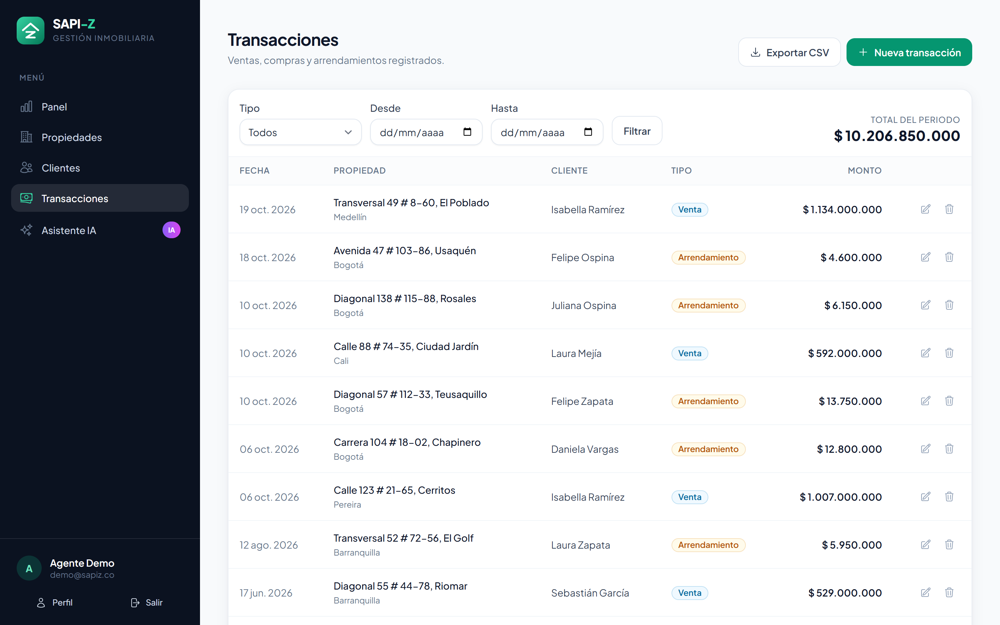
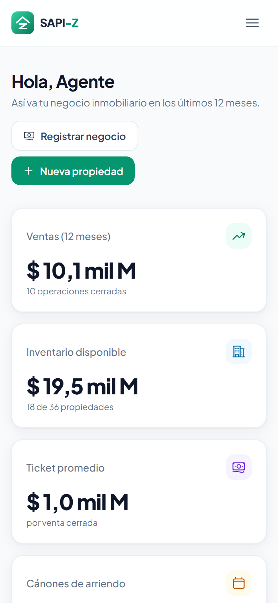

<div align="center">


# SAPI-Z

**Sistema de Administración de Propiedades Inmobiliarias con asistente de IA**

Gestiona inventario, clientes y negocios en un solo lugar, mide tu operación en un panel
y deja que la IA redacte anuncios, estime precios y responda preguntas sobre tu cartera.




</div>

---

## Contenido

- [Funcionalidades](#funcionalidades)
- [Capturas](#capturas)
- [Asistente de IA](#asistente-de-ia)
- [Inicio rápido](#inicio-rápido)
- [Pruebas](#pruebas)
- [Arquitectura](#arquitectura)
- [Licencia](#licencia)

## Funcionalidades

| Módulo | Qué incluye |
|---|---|
| **Panel** | Ventas de los últimos 12 meses, valor del inventario disponible, ticket promedio, cánones de arriendo, gráfica mensual, precio por m² por ciudad y actividad reciente. |
| **Propiedades** | Casas, apartamentos y locales con búsqueda, filtros por tipo y estado, ficha detallada, precio por m², historial de negocios y propiedades similares. |
| **Clientes** | Compradores, vendedores y arrendatarios con número de negocios y volumen movido por cada uno. |
| **Transacciones** | Ventas, compras y arrendamientos con filtros por tipo y fechas, total del periodo y exportación a CSV. |
| **Estado automático** | Al registrar una venta la propiedad pasa a *vendida*; un arriendo la marca *arrendada*; si se borra el negocio, vuelve a *disponible*. |
| **Asistente IA** | Redacción de anuncios, estimación de precio con comparables y chat sobre los datos de la cartera, con Claude. |

Además: validación en español (acepta montos como `$ 350.000.000`), formato de pesos colombianos, diseño responsive y protección para no borrar registros con negocios asociados.

## Capturas

<table>
  <tr>
    <td width="50%"><p align="center"><b>Portada pública</b></p></td>
    <td width="50%"><p align="center"><b>Inicio de sesión</b></p></td>
  </tr>
  <tr>
    <td><p align="center"><b>Inventario de propiedades</b></p></td>
    <td><p align="center"><b>Ficha de la propiedad</b></p></td>
  </tr>
  <tr>
    <td><p align="center"><b>Descripción y precio sugeridos por el asistente</b></p></td>
    <td><p align="center"><b>Chat sobre la cartera</b></p></td>
  </tr>
  <tr>
    <td><p align="center"><b>Clientes</b></p></td>
    <td><p align="center"><b>Transacciones con exportación CSV</b></p></td>
  </tr>
</table>

<p align="center">
  <br>
  <b>Vista móvil</b>
</p>

## Asistente de IA

El asistente usa **Claude** a través del [SDK oficial de Anthropic para PHP](https://github.com/anthropics/anthropic-sdk-php).

| Función | Cómo trabaja |
|---|---|
| **Redactar descripción** | Toma los datos del formulario y escribe un anuncio de dos párrafos sin inventar características. |
| **Estimar precio** | Busca comparables del inventario (mismo tipo y ciudad), calcula percentiles del precio por m² y le pide a Claude un rango justificado con **salida JSON estructurada**. |
| **Chat de la cartera** | Responde con los datos reales de propiedades, transacciones y clientes: *"¿qué propiedades llevan más tiempo disponibles?"*, *"resume las ventas del trimestre por ciudad"*. |

Detalles de la integración:

- Modelo configurable (`claude-opus-5-5` por defecto) con nivel de esfuerzo ajustable.
- *Fallbacks* del lado del servidor: si el modelo declina una petición, la API la reintenta con otro.
- El contexto de la cartera se envía con *prompt caching* para que las preguntas seguidas del chat sean más baratas.
- Límite de 15 solicitudes por minuto por usuario y respuestas en markdown sin HTML.

**Sin API key la app sigue funcionando en modo local**: plantilla para la descripción, estimación estadística con comparables y un resumen de la cartera en el chat. Para activar la IA:

```env
ANTHROPIC_API_KEY=sk-ant-...
ANTHROPIC_MODEL=claude-opus-5-5   # opcional
ANTHROPIC_EFFORT=low              # low | medium | high
```

## Inicio rápido

### Con Docker

```bash
git clone https://github.com/zemogc/SAPI-Z.git
cd SAPI-Z
docker compose up --build
```

Abre <http://localhost:8000> e ingresa con **`demo@sapiz.co`** / **`password`**. El primer arranque crea la base SQLite con 36 propiedades, 24 clientes y un año de transacciones de ejemplo.

Para activar el asistente: `ANTHROPIC_API_KEY=sk-ant-... docker compose up --build`.

### Instalación local

Requisitos: PHP 8.2+, Composer y Node.js 20+.

```bash
composer install
npm install && npm run build
cp .env.example .env
php artisan key:generate
touch database/database.sqlite
php artisan migrate --seed
php artisan serve
```

La configuración por defecto usa SQLite. Para MySQL, cambia `DB_CONNECTION` y las variables `DB_*` en `.env`.

## Pruebas

```bash
php artisan test
```

59 pruebas cubren el CRUD, las validaciones, la sincronización del estado de las propiedades, los indicadores del panel, la exportación CSV y el asistente. Las pruebas del asistente usan un proveedor falso y un transporte HTTP simulado que verifica la petición exacta enviada a la API, así que no consumen tokens.

## Arquitectura

```
app/
├── Http/
│   ├── Controllers/        Propiedades, clientes, transacciones, panel y asistente
│   └── Requests/           Validación y normalización de montos
├── Models/                 Propiedad, Cliente, Transaccion (+ sincronización de estado)
├── Services/IA/
│   ├── ProveedorIA.php     Contrato del modelo de lenguaje
│   ├── ClaudeProveedor.php Implementación con el SDK de Anthropic
│   └── AsistenteInmobiliario.php  Comparables, prompts y modo local
└── Support/helpers.php     cop(): formato de pesos colombianos
resources/
├── views/                  Blade + componentes (icon, badge, field, flash…)
└── js/                     Alpine.js, gráficas con Chart.js y cliente del asistente
```

**Stack:** Laravel 11 · Blade · Tailwind CSS · Alpine.js · Chart.js · SQLite/MySQL · SDK de Anthropic · PHPUnit.

## Licencia

Distribuido bajo la licencia MIT. Consulta [LICENSE](LICENSE).

<p align="center">Hecho por <a href="https://github.com/zemogc">Zemog Gomez</a></p>
